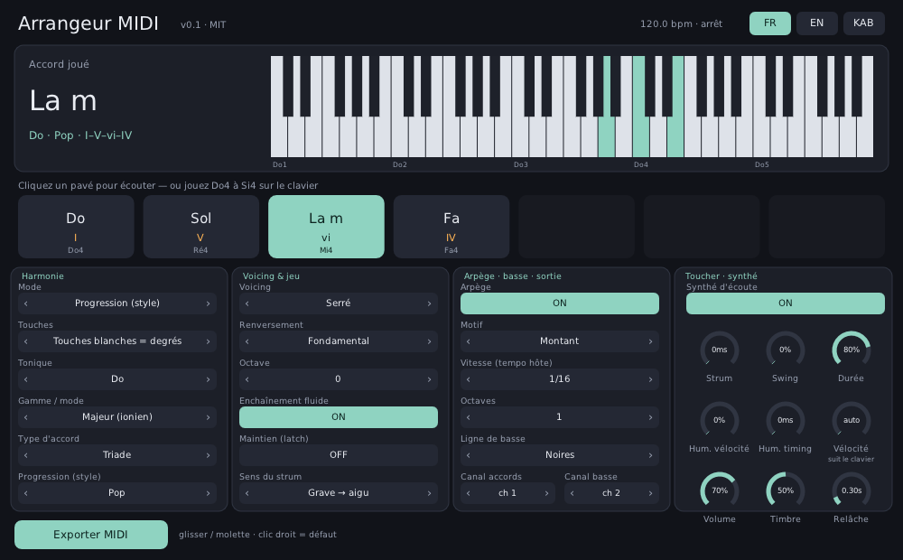

# Arrangeur MIDI — accords, arpèges, strum et basse en une touche (VST3 / VST2 / CLAP, gratuit)



**🇫🇷 Arrangeur MIDI** joue un **accord complet** quand vous appuyez sur **une seule touche**, toujours **dans la bonne gamme** : majeur, mineur, modes (dorien, phrygien…), **Hijaz, Hijaz Kar, Nahawand, Kurd, Bayati, Rast, Saba** (maqâms arrondis au demi-ton), pentatoniques, blues. Il ajoute un **strum** (comme une guitare), un **arpégiateur** calé sur le tempo de FL Studio, une **ligne de basse**, de l'**humanisation**, des **progressions toutes prêtes par style** (pop, jazz, néo-soul, cadence andalouse, Hijaz/chaâbi, raï/Maghreb, Kurd…) et **exporte un fichier MIDI**. Un **petit synthé d'écoute intégré** le fait sonner tout seul.
**🇬🇧** A free, open-source chord / arpeggio / strum / bass generator: one key plays a full chord in the chosen key and scale (modes, maqam approximations), with voicings and voice leading, a tempo-synced arpeggiator, a bass line, humanize, style presets, MIDI out, MIDI file export and a built-in preview synth. English section below.
**ⵣ Taqbaylit** : tigezmi s Teqbaylit ddaw-a.

- Téléchargement : **[dernière version (Releases)](https://github.com/salimadour31-boop/arrangeur-midi/releases/latest)** — Windows x64, macOS (universel, non signé), Linux x64.
- Formats : **VST3**, **VST2** (le plus fiable pour la sortie MIDI dans FL Studio), CLAP, LV2 (Linux).
- Licence : **MIT**.

> ⚠️ Version 0.1. Testée automatiquement (voir « Tests »), **pas encore essayée dans FL Studio sur un vrai PC Windows** : vos retours sont bienvenus (onglet *Issues*).

## 🚀 Démarrer (FL Studio, Windows)

### 1. Installer
1. Téléchargez `arrangeur-midi-windows-x64.zip` dans les [Releases](https://github.com/salimadour31-boop/arrangeur-midi/releases/latest) et décompressez-le.
2. Copiez **`arrangeur-midi.vst3`** dans **`C:\Program Files\Common Files\VST3`** (acceptez la demande administrateur).
3. Copiez aussi **`arrangeur-midi-vst2.dll`** dans votre dossier de plugins VST2 (par exemple `C:\Program Files\VSTPlugins` — créez-le s'il n'existe pas ; dans FL Studio, vérifiez qu'il figure dans **Options › Manage plugins › Plugin search paths**).
4. Dans FL Studio : **Options › Manage plugins** → **Find installed plugins**. « Arrangeur MIDI » apparaît parmi les **Generators** (instruments) : cochez l'**étoile** pour le mettre en favori.

### 2. Faire de la musique tout de suite (sans rien brancher)
1. Dans le **Channel Rack** (F6) : **+** › **Arrangeur MIDI**. C'est un **instrument** : il fait du son grâce à son synthé d'écoute.
2. Choisissez la **Tonique** (ex. *La*) et la **Gamme / mode** (ex. *Mineur naturel* ou *Hijaz*).
3. Jouez les **touches blanches de Do4 à Si4** (clavier MIDI, clavier de l'ordinateur, ou cliquez les **7 pavés** de l'interface) : Do = accord I, Ré = accord II, Mi = accord III… Chaque touche joue un accord **qui sonne juste dans la gamme**, quelle que soit la tonique choisie.
4. Pour enregistrer une suite d'accords : ouvrez le **piano roll** du canal et écrivez des notes Do, Ré, Mi… (une note = un accord, sa longueur = la durée de l'accord).
5. Activez l'**Arpège** : il suit le tempo du projet quand vous lancez la lecture.

**Mode « Progression (style) »** : les touches Do, Ré, Mi, Fa… jouent les accords 1, 2, 3, 4… d'une progression célèbre (pop I–V–vi–IV, jazz ii–V–I, cadence andalouse, Hijaz/chaâbi…) transposée dans votre tonique.

### 3. Piloter un autre instrument (Serum, Vital, Kontakt, FLEX…)
Arrangeur MIDI envoie aussi ses notes en **MIDI** (accords sur le canal 1, basse sur le canal 2 par défaut). Coupez le **Synthé d'écoute** (OFF) pour n'entendre que l'instrument piloté.

**Vers un plugin VST (Vital, Serum, Kontakt…)** — méthode des ports de FL Studio :
1. Ouvrez Arrangeur MIDI, cliquez la **roue dentée** (en haut à gauche de la fenêtre) → réglages du *wrapper* → partie **MIDI** → **Output port** = **1**.
2. Ajoutez votre instrument dans le Channel Rack, ouvrez **sa** roue dentée → **MIDI** → **Input port** = **1** (même numéro).
3. Jouez sur le canal **Arrangeur MIDI** : l'autre instrument joue les accords.
> 💡 D'après les retours d'autres éditeurs, la sortie MIDI des plugins **VST3** ne passe pas dans certaines versions de FL Studio. **Si rien n'arrive, chargez la version VST2** d'Arrangeur MIDI (dossier *VST* des Generators dans le navigateur de plugins) : c'est pour ça qu'elle est fournie.

**Vers un instrument interne de FL Studio (FLEX, 3xOsc, Sytrus…)** — méthode **Patcher** :
1. Réglez d'abord l'**Output port** d'Arrangeur MIDI (étape 1 ci-dessus).
2. Clic droit sur le canal Arrangeur MIDI dans le Channel Rack → **Patcherize**.
3. Dans la fenêtre Patcher : clic droit dans le vide → **Insert plugin** → choisissez FLEX (ou autre).
4. Reliez la **sortie MIDI / événements** d'Arrangeur MIDI (connecteur à droite de son bloc) à l'**entrée** de FLEX, puis la sortie **audio** de FLEX à **To FL Studio**.

**Sans aucun routage : Exporter MIDI.** Le bouton **Exporter MIDI** écrit un fichier `.mid` (progression du style choisi, 2 tours, avec vos réglages : voicing, strum, arpège, basse, humanisation) dans **`Documents\Arrangeur MIDI`**. Glissez ce fichier depuis l'Explorateur Windows dans la **Playlist** ou le **Channel Rack** de FL Studio (ou dans le piano roll : *File › Import › MIDI file*). Les accords et la basse sont sur deux pistes séparées.

## 🎛️ Les réglages
| Réglage | Effet |
|---|---|
| **Mode** | *Accords de la gamme* / *Progression (style)* / *Désactivé* (les notes passent telles quelles) |
| **Touches** | *Touches blanches = degrés* (Do = I, Ré = II… le plus simple) ou *Note jouée (aimantée)* (la note jouée est ramenée sur la gamme et devient la fondamentale) |
| **Tonique, Gamme / mode** | 12 toniques × 19 gammes (dont modes, maqâms, pentatoniques, blues). Les points sur le clavier montrent les notes de la gamme |
| **Type d'accord** | triade, septième, neuvième, sus2, sus4, quinte (power chord), add9 — toujours construits avec les notes de la gamme |
| **Progression (style)** | 12 préréglages : Pop, Ballade, Années 50, Jazz ii–V–I, Néo-soul, Blues, Mineur épique, Cadence andalouse, Hijaz / chaâbi, Raï / Maghreb, Kurd / mélancolie, Trap sombre |
| **Voicing, Renversement, Octave** | serré, ouvert (basse grave), drop 2, large ; fondamental / 1er / 2e / 3e renversement |
| **Enchaînement fluide** | *voice leading* : choisit le renversement qui bouge le moins d'un accord à l'autre, en restant dans le même registre |
| **Maintien (latch)** | l'accord continue après avoir lâché la touche, jusqu'à la suivante |
| **Strum, Sens du strum** | décale les notes de 0 à 300 ms, grave → aigu, aigu → grave ou alterné (effet guitare) |
| **Arpège** : Motif, Vitesse, Octaves, Swing, Durée | 7 motifs (montant, descendant, montant-descendant, aléatoire, pouce, brisé, accord rythmique), 1/1 à 1/32 avec triolets, 1 à 4 octaves, swing 0–100 %, durée des notes |
| **Ligne de basse** | fondamentale tenue, noires, fondamentale-quinte, octaves en croches, syncopée (calée sur la mesure) |
| **Hum. vélocité / timing** | variations aléatoires de force et de placement (0–40 ms, toujours en retard, jamais en avance) |
| **Vélocité** | *auto* = suit la force de frappe, sinon valeur fixe |
| **Canal accords / basse** | canaux MIDI de sortie (1–16) |
| **Synthé d'écoute** | volume, timbre, relâche |

Tous les réglages sont **automatisables** dans FL Studio. Clic droit sur un réglage = valeur par défaut ; molette = pas à pas.

## ✅ Tests
- **250 vérifications hors ligne** (`tests/test_music.cpp`) : gammes, accords de chaque degré (y compris Hijaz), noms d'accords, progressions, renversements, drop 2, voice leading (au moins 2× moins de mouvement), strum, arpège **exactement sur la grille du tempo** (à l'échantillon près), swing, durée, suivi du tempo, transport arrêté / en boucle, 5 lignes de basse, humanisation bornée, **400 sessions aléatoires sans aucune note bloquée**, fichier MIDI relu, synthé.
- **pluginval** (Tracktion), niveau de sévérité **10** : réussi pour le VST3 et le VST2 (Linux, en CI).
- **Hôte CLAP minimal** (`tools/clap_midi_check.c`) : joue des notes avec un transport à 120 bpm et vérifie les notes MIDI **sortant** du plugin (accord sur le canal 1, basse sur le canal 2, arpège sur la grille) et le son du synthé.
- CI GitHub Actions : compilation Windows / macOS / Linux, tests, pluginval, paquets et Release.

## ⚠️ Limites (honnêtes)
- **Pas encore testé dans FL Studio** sur un vrai PC : la sortie MIDI est vérifiée par un hôte de test, pas dans FL. La sortie MIDI **VST3** peut ne pas fonctionner dans certaines versions de FL Studio → utilisez la **VST2** ou l'**export MIDI**.
- Les **maqâms** sont arrondis au demi-ton (pas de quarts de ton) : Bayati et Rast sont des approximations.
- Les lignes de basse supposent une mesure à **4 temps**.
- Une seule touche active à la fois (la dernière jouée gagne), comme une « mémoire d'accord ».
- Pas de détection d'accords depuis l'audio, pas de suggestions intelligentes de suite d'accords.
- L'export MIDI écrit dans un dossier fixe (pas de glisser-déposer direct depuis la fenêtre du plugin).
- macOS : binaires **non signés** (clic droit › Ouvrir, ou autoriser dans *Réglages › Confidentialité*).
- Le **VST2** utilise un en-tête VST2 libre écrit par rétro-ingénierie (inclus dans DPF) ; Steinberg ne délivre plus de licence VST2.

## 🛠️ Compiler
```bash
git clone --recursive https://github.com/salimadour31-boop/arrangeur-midi.git
cd arrangeur-midi
cmake -S . -B build -DCMAKE_BUILD_TYPE=Release
cmake --build build --config Release
ctest --test-dir build -C Release      # tests de la logique musicale
```
Linux : `sudo apt install libx11-dev libxext-dev libxrandr-dev libxcursor-dev libgl1-mesa-dev libdbus-1-dev`.

---

## 🇬🇧 English

**Arrangeur MIDI** is a free (MIT) instrument plugin for arrangers: press **one key** and get a **full chord in the chosen key and scale** (major/minor, the 7 modes, harmonic/melodic minor, Hijaz, Hijaz Kar, Nahawand, Kurd, Bayati≈, Rast≈, Saba≈, pentatonics, blues), with **voicings** (close, open, drop 2, wide), inversions and **voice leading**, **strum**, a **host-synced arpeggiator** (7 patterns, 1/1–1/32 incl. triplets, swing, gate, 1–4 octaves), an optional **bass line** (5 patterns, separate MIDI channel), **humanize**, **12 style presets** (pop, ballad, 50s, jazz ii–V–I, neo-soul, blues, epic minor, Andalusian cadence, Hijaz/chaabi, Rai/Maghreb, Kurd, dark trap), **MIDI output**, **MIDI file export** and a **built-in preview synth**.

**FL Studio quick start**: copy `arrangeur-midi.vst3` to `C:\Program Files\Common Files\VST3` (and `arrangeur-midi-vst2.dll` to your VST2 folder), run *Options › Manage plugins › Find installed plugins*, add it to the Channel Rack and play the white keys C4–B4 (C = chord I, D = chord II…). It sounds on its own.
**Driving another synth**: plugin cog → *MIDI Output port* = 1, target synth cog → *MIDI Input port* = 1. FL's native instruments: *Patcherize* the channel and wire Arrangeur's MIDI out to the instrument. If the VST3's MIDI output does not reach the target in your FL version (a known FL/VST3 issue), use the VST2 build, or **Export MIDI** (writes a `.mid` to `Documents/Arrangeur MIDI`, drag it into FL).
**Verified**: 250 offline checks (incl. sample-accurate arp timing and 400 random sessions with no stuck notes), pluginval strictness 10 (VST3 + VST2), a CLAP host test reading the plugin's MIDI output, CI on Windows/macOS/Linux. **Not yet tested inside FL Studio.** Limits: maqams rounded to 12-TET, bass patterns assume 4/4, one active chord at a time, unsigned macOS binaries.

## ⵣ Taqbaylit

**Arrangeur MIDI** d asiɣzef (plugin) n baṭel : tsseḍ ɣef **yiwet n tsarut**, ad d-yurar **akurd ummid** deg teskala i tferneḍ (ameqqran, amecṭuḥ, modes, Ḥijaz, Kurd, Nahawand…). Yesɛa daɣen **strum**, **arpège** yeṭṭafaren tempo n FL Studio, **abas**, **agaman** (humanize), **ikalaten yemmugen** (pop, jazz, Ḥijaz / caɛbi, raï…) d **usifeḍ n ufaylu MIDI**. Yesɛa asinti amecṭuḥ : yettṣuṭu iman-is.

**Amek ara t-tesseqdceḍ deg FL Studio** : ɛeddi `arrangeur-midi.vst3` ɣer `C:\Program Files\Common Files\VST3`, ldi *Options › Manage plugins › Find installed plugins*, rnu-t ɣer Channel Rack, syin urar tisura timellalin Do4 ar Si4 (Do = akurd I, Ré = akurd II…). Akken ad tesqedceḍ asinti-nniḍen : roue dentée › *MIDI Output port* = 1, deg usinti-nniḍen *Input port* = 1 ; ma ur yeddi ara, seqdec lqem VST2 neɣ taqeffalt **Sifeḍ MIDI**.

Ur yettwaɛreḍ ara yakan deg FL Studio ɣef PC n tidet : ceyyɛet-aɣ-d tamuɣli-nwen (Issues).

## Licence
MIT © 2026 salimadour31-boop — voir [LICENSE](LICENSE) et [THIRD_PARTY.md](THIRD_PARTY.md).
